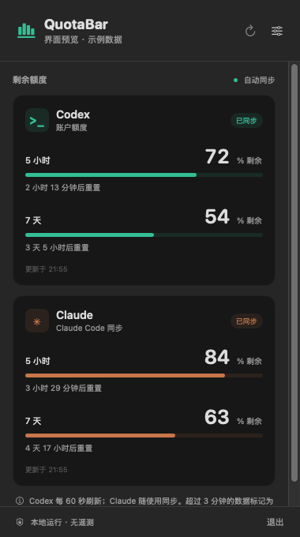

# QuotaBar

原生 macOS 菜单栏 AI 额度工具。SwiftUI + AppKit，MIT 开源，无第三方运行依赖、无遥测、无自建服务器。

[下载已公证 Apple 芯片版 DMG](https://github.com/woodti/QuotaBar/releases/latest) · [反馈问题](https://github.com/woodti/QuotaBar/issues) · [参与贡献](CONTRIBUTING.md)

## 功能

- Codex：通过官方 `codex app-server` 的 `account/rateLimits/read` 查询账户用量，默认每 60 秒刷新，可选 30 / 120 秒。
- Claude：通过官方 Claude Code status line 的 `rate_limits` 字段同步五小时、七天和支出上限窗口；使用时更新，非独立云端轮询。
- 显示剩余百分比、进度条、重置倒计时、多额度池、更新时间。支持浅色 / 深色系统外观。
- Codex 卡片显示服务返回的套餐类型（例如 Pro、Plus、Pro Lite、基础版）和只读授权状态。未知套餐标签原样显示；服务未返回该字段时不猜测。
- 菜单栏可显示 Codex、Claude 或两者；显示所有有效窗口中最少的剩余额度。
- 超过三分钟的快照标记为旧数据；重置时间到达后等待服务确认，不自行假设额度恢复。失败和未知值不会被当成零或 100%。
- 登录时启动、睡眠唤醒刷新、手动刷新、可自选 Codex 路径。
- 通过本地 JSON 文件扩展其他服务（尚未内置 Gemini、Cursor、Copilot 等连接器）。

## 安装

需要 macOS 13 或以上及 Apple Silicon（M 系列芯片）。从 [最新 Release](https://github.com/woodti/QuotaBar/releases/latest) 下载 `QuotaBar-0.2.5-macos-arm64-notarized.dmg`，打开后将 QuotaBar 拖入 Applications，再打开。菜单栏会出现图表图标和 `CX` / `CL` 额度。

首次使用：

1. 先在终端运行 `codex login`，使用 ChatGPT 账户完成登录。
2. 打开 QuotaBar，等待自动刷新；也可以点击右上角刷新按钮。
3. 如果仍然没有额度，打开设置确认 Codex 路径，或在设置中选择实际的 `codex` 可执行文件。

QuotaBar 只读取 Codex CLI 自己的登录状态，不会复制凭证。读取失败时，面板会保留旧数据并显示“打开设置”和“重试”入口；请在提交问题时附上错误文字、macOS 版本和 Codex 版本，不要附带 token、Cookie 或账户文件。

正式发布包已使用 Developer ID 签名并通过 Apple 公证。支持显示账户实际提供的额度窗口；套餐不提供 5 小时限额时不会显示该窗口。



自行构建且未提供签名配置的产物只有 ad-hoc 签名，未经过 Apple Developer ID 签名和公证。通过网络分发后，Gatekeeper 可能拦截；可信来源可按 macOS「隐私与安全性」中的系统提示允许打开，或从源码自行构建。面向公众免提示分发，维护者应使用自己的 Apple Developer ID 签名并公证，见下文。源码不包含任何证书或登录信息。

### Homebrew 安装（Apple Silicon）

这台开发机使用 Apple Silicon，所以公开发布只提供 arm64 DMG。已提供 Homebrew Cask：

```sh
brew tap woodti/tap
brew install --cask quotabar
```

Cask 会下载同一个已签名、公证的 DMG，并要求 Apple Silicon 和 macOS 13+。卸载使用 `brew uninstall --cask quotabar`。

### English quick start

Download the latest notarized Apple Silicon DMG from [Releases](https://github.com/woodti/QuotaBar/releases/latest), open it, and drag QuotaBar to Applications. Or install it with Homebrew:

```sh
brew tap woodti/tap
brew install --cask quotabar
```

For Codex, run `codex login` first, then open QuotaBar and press refresh. For Claude Code, click “接入 Claude Code” in Settings, start one Claude conversation, and wait for the first API response. The app reads local status data and does not upload prompts, code, or credentials.

### Codex

先安装 Codex CLI 并使用 ChatGPT 账户完成 `codex login`；也会尝试检测常见 Codex / ChatGPT 桌面安装位置。非标准安装可在设置中选择 Codex 可执行文件。应用复用 CLI 自己管理的登录状态，不复制凭证。

API Key 账户不等同于 ChatGPT 订阅额度。若服务不返回百分比窗口，会明确显示不可用。团队额度、积分制及特殊计划的可见字段由服务决定；当前只展示百分比窗口。

### Claude

1. 先将应用固定安装到 `/Applications`。
2. 点击应用里的「接入 Claude Code」。程序会备份 `~/.claude/settings.json`，并添加 `statusLine` 命令；设置中的其他字段保持原样。支持通过环境变量 `CLAUDE_CONFIG_DIR` 指定配置目录（Finder 启动时通常没有终端环境变量）。
3. 已有状态栏命令会收到原始 stdin，并继续显示原来的输出。QuotaBar 仅保存额度字段和时间，不保存会话正文。
4. 使用支持 `rate_limits` 的新版 Claude Code，在支持的订阅账户中完成一次对话。官方字段通常只在首次 API 响应之后出现；某些账户不提供这些字段。

Claude 停用时不会主动联网查询，旧数据会明确标注。移动 / 删除应用会使状态栏命令路径失效。卸载前，从 `settings.json.quotabar-backup-*` 恢复原来的 `statusLine` 字段（保留之后其他设置改动），或者删除 QuotaBar 新增的 `statusLine` 字段。

## 开发

安装 Xcode 或带 Swift 5.9+ 的 Command Line Tools：

```sh
swift build
swift test
swift run QuotaBar
# 只读检查本机 Codex，不触发模型推理
swift run QuotaBar --check-codex
# 使用明确标识的示例数据预览
swift run QuotaBar --demo
```

若系统仅有 Command Line Tools 且缺少 XCTest，可运行 `./scripts/test-core.sh`；该脚本用独立断言执行同一组核心用例（需要 Python 3），也可安装完整 Xcode 后运行 `swift test`。

项目结构：

- `Sources/QuotaCore`：协议读取、解析、数据新鲜度、Claude 接入、本地文件格式。
- `Sources/QuotaBar`：菜单栏、卡片界面、设置和刷新调度。
- `Tests/QuotaCoreTests`：多个额度池、缺失值、过期、Claude 字段、配置备份、RPC 握手与超时。
- `scripts/package.sh`：独立构建可分发 `.app` / ZIP，并可选签名与公证。
- `.github/workflows/build.yml`：macOS 构建、测试和Apple Silicon 构建产物。

## 打包和发布

```sh
./scripts/package.sh arm64
```

输出在 `dist/`。目前仅发布 Apple Silicon 版本。GitHub Actions 产物仅用于构建验证，未经 Apple 公证；正式安装包单独通过 Release 发布。

本项目不分发维护者的签名私钥。Fork 维护者需要使用自己的 Apple 开发者账号。

维护者可设置自己的签名身份和已配置的 notarytool Keychain profile：

```sh
SIGN_IDENTITY='Developer ID Application: Your Name (TEAMID)' \
NOTARY_PROFILE='your-notary-profile' \
./scripts/package.sh arm64
```

程序会先签名、提交公证、staple，然后重新打包。不要把证书、私钥或 token 提交到 Git。

## 扩展其他服务

设置中打开数据源文件夹：

`~/Library/Application Support/QuotaBar/Providers/`

每个服务一个 JSON 文件，由你自己的适配器更新；QuotaBar 每两秒重新读取。协议例子：

```json
{
  "id": "my-provider",
  "name": "My AI",
  "observedAt": "2026-10-23T05:00:00Z",
  "windows": [
    {
      "id": "monthly",
      "label": "月度额度",
      "usedPercent": 35.5,
      "resetsAt": "2026-11-01T00:00:00Z"
    }
  ]
}
```

`observedAt` 必须是实际获取数据的时间，不能仅因读缓存而刷新时间。时间为 ISO 8601 UTC（无小数秒）；`resetsAt` 可省略。百分比是已用比例；界面自动转为剩余比例。单文件限 1 MB、最多 20 个窗口，最多加载 20 个自定义文件。适配器应原子替换文件，避免读取半写入状态。自定义服务显示在弹出面板中，菜单栏固定选择 Codex / Claude。

扩展不会执行导入文件中的命令；获取其他厂商数据的认证和刷新由各自适配器负责。不要将 token、Cookie 或账户密钥写入额度文件。

## 数据与隐私

Codex 请求通过用户已安装的官方 CLI 发出，不创建对话或调用模型。每次请求有 20 秒超时，结束后关闭子进程。CLI 自身的联网及日志行为由其配置决定。

Claude 桥接只写入 `~/Library/Application Support/QuotaBar/claude.json` 的归一化额度快照。原有状态栏命令的行为仍由用户自己的配置决定。QuotaBar 没有分析统计、遥测、广告或账户上传服务。

## 上游文档

- [Codex app-server：初始化与账户额度 API](https://developers.openai.com/codex/app-server)
- [Claude Code status line：rate_limits 字段与更新时机](https://code.claude.com/docs/en/statusline)

非 OpenAI 或 Anthropic 官方产品。上游接口、账户计划和额度字段可能变化。
